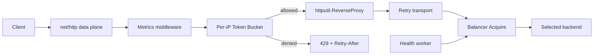

# Архитектура и конкурентность

Основной сервер принимает пользовательские запросы. Отдельный admin-сервер
публикует `/metrics`, `/healthz`, `/readyz`: эти запросы не расходуют токены.
`ReverseProxy` управляет hop-by-hop headers, request/response body, forwarding
headers и объединением base path upstream с URL. Retry transport выбирает peer
непосредственно перед отправкой. Каждый attempt использует копию запроса.

## Владение состоянием

| Состояние | Владелец | Синхронизация |
| --- | --- | --- |
| URL | Backend | Неизменяемый; наружу возвращается копия |
| Alive | Backend | `sync.RWMutex` |
| Активные HTTP-запросы | Backend | `atomic.Int64` |
| Позиция Round Robin и выбор | Balancer pool | `sync.Mutex` |
| IP → bucket и tokens | Limiter | Один `sync.Mutex` |
| Освобождение reservation | Lease | `sync.Once` |
| Workers | Application | Context, WaitGroup |
| Ошибки серверов | Application | Буферизованный channel |

Один пул использует один экземпляр балансировщика. Выбор и увеличение счётчика
выполняются под одним mutex: раздельные Next/Increment позволили бы параллельным
запросам выбрать один минимально загруженный peer. Release атомарен и не требует
pool mutex. Lease живёт до закрытия upstream response body, учитывая медленную
передачу ответа. Failed attempt освобождает reservation перед следующей попыткой.

Least Connections считает HTTP-запросы, а не TCP-сокеты: keep-alive и HTTP/2
multiplexing делают sockets слабой оценкой нагрузки. Round Robin обычно O(1),
но при пропуске unhealthy peers — O(N). Least Connections сканирует O(N).
Для небольших пулов это проще структуры с обновлением на каждом completion.

## Failover

- `MAX_ATTEMPTS` включает исходную попытку; каждый peer посещается максимум один раз.
- Retry только GET/HEAD/OPTIONS с пустым или воспроизводимым телом.
- POST/PUT/PATCH/DELETE не повторяются: upstream мог выполнить запись даже при timeout.
- Transport error или 5xx переводит peer в Dead; active check возвращает его в ротацию.
- Client cancellation не переводит исправный peer в Dead.
- После отправки headers downstream retry невозможен.

`UPSTREAM_TIMEOUT` — общий бюджет всех attempts и response body. Header timeout
равен ему, делённому на `MAX_ATTEMPTS`; dial ограничен `DIAL_TIMEOUT`.
Эти ограничения не гарантируют выполнение всех attempts: время записи body,
dial и уже потраченный бюджет могут завершить запрос раньше.
Финальный 5xx возвращается клиенту. Если после промежуточного 5xx peers больше
нет — 502; если peers не было до первой попытки — 503; timeout/deadline — 504.
Ошибка чтения начатого response body помечает peer Dead и прерывает ответ.

Health worker проверяет `/health` в корне upstream независимо от base path.
Healthy — только 2xx; redirects не отслеживаются. Один раунд запускает goroutine
на каждый peer, следующий раунд не перекрывает предыдущий. Backend стартует
Dead до начальной проверки. Изменение Alive не отменяет зарезервированные attempts.
Probe и реальный запрос могут наблюдать разные состояния сервиса: применяется
последнее наблюдение. Hysteresis и circuit-breaker backoff здесь отсутствуют.

## Token Bucket

Refill: `min(burst, tokens + elapsed_seconds * rate)`. Разрешённый запрос
списывает token. Отказ возвращает время до следующего token; Retry-After
округляется вверх до секунд, минимум 1. Используется monotonic time Go.

Cleanup удаляет idle entries. TTL не короче полного refill: иначе eviction
истощённого bucket выдал бы новый burst раньше времени. Reject обновляет last seen.
`MAX_CLIENTS` ограничивает память при уникальных IP; при заполнении новые IP
получают 429 до освобождения места, существующие продолжают обслуживаться.

Cleanup O(M) под mutex временно блокирует Allow. Sharding и incremental cleanup
имеют смысл после профилирования. Лимит локален процессу; restart сбрасывает tokens.

## Shutdown

SIGINT/SIGTERM запускают два Shutdown параллельно с общим deadline. Входящие
requests не используют signal context и могут завершиться в пределах своих
таймаутов. После drain останавливаются workers и закрываются idle upstream
connections. Превышение shutdown deadline приводит к forced close и exit 1.
Upgrade/CONNECT отклоняются: hijacked connections не входят в управление Shutdown.
